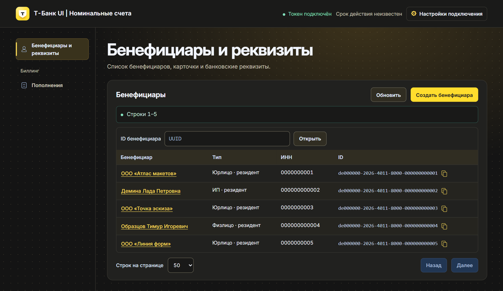
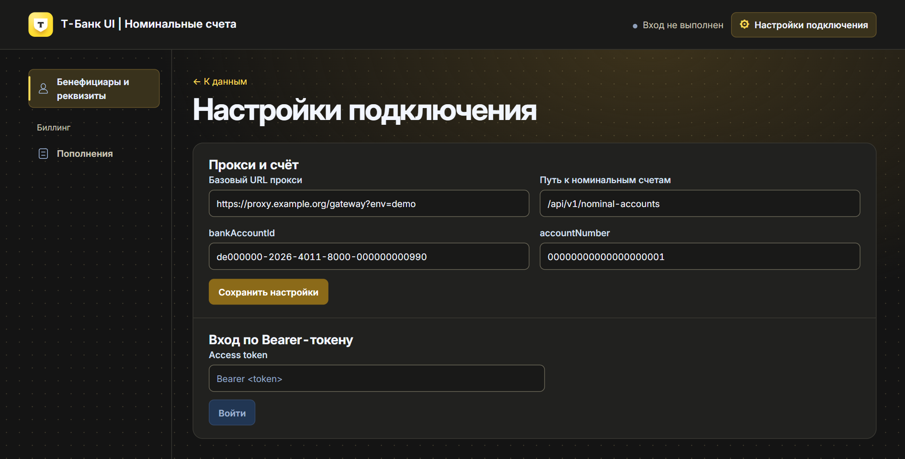

# Т-Банк UI | Номинальные счета

Локальный браузерный инструмент для ведения бенефициаров и их банковских счетов, а также просмотра и идентификации пополнений. Для работы нужен доступ к прокси вашей организации и действующий Bearer-токен для этого прокси.

На скриншотах показаны вымышленные организации, реквизиты и операции.

## Быстрый старт на Windows

1. Скачайте исходники через **Code → Download ZIP** и распакуйте архив целиком. Можно также клонировать репозиторий.
2. Если прокси доступен из внутренней сети, подключитесь к ней или к VPN.
3. Дважды щёлкните `start.cmd`. Он запустит локальный сервер и откроет в браузере `http://127.0.0.1:8765/`. Если браузер не открылся автоматически, адрес также виден в консоли.
4. В правом верхнем углу откройте **⚙ Настройки подключения**, заполните параметры прокси и нажмите **Сохранить настройки**.
5. В блоке **Вход по Bearer-токену** вставьте access token или строку `Bearer <token>` и нажмите **Войти**. Откроется первая страница с 50 бенефициарами.
6. Чтобы остановить сервер, закройте окно или вкладку терминала, в которой работает `start.cmd`.

Для запуска достаточно встроенного Windows PowerShell и современного браузера. Установка пакетов, права администратора и изменение политики выполнения PowerShell не требуются. Оставьте `start.cmd`, `server.commands` и папку `dist` рядом.

## Подключение и данные

| Поле | Что указать |
| --- | --- |
| Базовый URL прокси | HTTPS-адрес вашего прокси. Можно включить префикс и query-параметры, например `https://proxy.example.org/gateway?env=test`. Для локального тестового прокси поддерживается HTTP на `127.0.0.1` с отдельным портом. |
| Путь к номинальным счетам | По умолчанию `/api/v1/nominal-accounts`. Измените, если прокси использует другой маршрут. |
| `bankAccountId` | UUID номинального счёта, если его требует прокси. При заполнении UI передаёт одноимённый заголовок во всех запросах данных. |
| `accountNumber` | Номер номинального счёта из 20 или 22 цифр. UI передаёт его в query при загрузке списка пополнений и остатков на виртуальных счетах. |
| Access token | Действующий токен, который принимает ваш прокси. |

При запуске из нового профиля браузера поля адреса, идентификатора, номера счёта и токена пусты. Кнопка **Сохранить настройки** записывает параметры подключения в `localStorage` текущего браузера. Токен хранится в памяти вкладки. Для JWT с полем `exp` в шапке отображается время до окончания сеанса. После перезагрузки страницы, истечения срока или ответа метода `401` потребуется ввести действующий токен.

## Поддерживаемые методы

Все пути указаны относительно `/api/v1/nominal-accounts`. Ссылка в первом столбце ведёт к описанию метода в T‑API. Данные для таблиц и карточек приложение получает через прокси, указанный в настройках. [Номинальные счета в T‑Bank Dev Portal](https://developer.tbank.ru/docs/products/nominal)

### Бенефициары

| Метод T‑API | Что делает интерфейс |
| --- | --- |
| [`GET /beneficiaries`](https://developer.tbank.ru/docs/api/get-api-v-1-nominal-accounts-beneficiaries) | Список с пагинацией по `offset` и `limit`. При входе UI загружает первые 50 записей. |
| [`GET /beneficiaries/{beneficiaryId}`](https://developer.tbank.ru/docs/api/get-api-v-1-nominal-accounts-beneficiaries-beneficiaryid) | Карточка по UUID. В разделе бенефициаров показывает детальные данные, в форме идентификации пополнения — имя или название, тип и ИНН при наличии. |
| [`POST /beneficiaries`](https://developer.tbank.ru/docs/api/post-api-v-1-nominal-accounts-beneficiaries) | Создание бенефициара. Тип определяет поля формы, в том числе адреса и документы. UI передаёт `Idempotency-Key`. |
| [`PUT /beneficiaries/{beneficiaryId}`](https://developer.tbank.ru/docs/api/put-api-v-1-nominal-accounts-beneficiaries-beneficiaryid) | Сохранение изменений из карточки. UI отправляет полные данные выбранного типа вместе с заполненными адресами и документами. |

### Банковские реквизиты

| Метод T‑API | Что делает интерфейс |
| --- | --- |
| [`GET /beneficiaries/{beneficiaryId}/bank-details`](https://developer.tbank.ru/docs/api/get-api-v-1-nominal-accounts-beneficiaries-beneficiaryid-bank-details) | Все реквизиты в карточке бенефициара. UI последовательно загружает страницы по 50 и собирает одну таблицу. |
| [`GET /beneficiaries/{beneficiaryId}/bank-details/{bankDetailsId}`](https://developer.tbank.ru/docs/api/get-api-v-1-nominal-accounts-beneficiaries-beneficiaryid-bank-details-bankdetailsid) | Открытие реквизитов по строке таблицы или UUID. Перед редактированием UI запрашивает актуальные данные счёта. |
| [`POST /beneficiaries/{beneficiaryId}/bank-details`](https://developer.tbank.ru/docs/api/post-api-v-1-nominal-accounts-beneficiaries-beneficiaryid-bank-details) | Добавление банковского счёта (`PAYMENT_DETAILS`) по кнопке **Добавить реквизиты**. UI передаёт `Idempotency-Key`. |
| [`PUT /beneficiaries/{beneficiaryId}/bank-details/{bankDetailsId}`](https://developer.tbank.ru/docs/api/put-api-v-1-nominal-accounts-beneficiaries-beneficiaryid-bank-details-bankdetailsid) | Сохранение изменений банковских реквизитов из формы редактирования. |
| [`POST /beneficiaries/{beneficiaryId}/bank-details/{bankDetailsId}/set-default`](https://developer.tbank.ru/docs/api/post-api-v-1-nominal-accounts-beneficiaries-beneficiaryid-bank-details-bankdetailsid-set-default) | Назначение выбранного счёта основным после подтверждения. Результат виден в столбце **По умолчанию**. |
| [`DELETE /beneficiaries/{beneficiaryId}/bank-details/{bankDetailsId}`](https://developer.tbank.ru/docs/api/delete-api-v-1-nominal-accounts-beneficiaries-beneficiaryid-bank-details-bankdetailsid) | Удаление выбранных реквизитов после подтверждения и обновление таблицы. |

### Остатки на виртуальных счетах

| Метод T‑API | Что делает интерфейс |
| --- | --- |
| [`GET /virtual-accounts/balances`](https://developer.tbank.ru/docs/api/get-api-v-1-nominal-accounts-virtual-accounts-balances) | Кнопки **Показать баланс** в карточке и **Проверить бенефициара** при распределении пополнения. UI передаёт `beneficiaryId`, `offset`, `limit=50` и `accountNumber`, если он задан в настройках. |

### Пополнения и идентификация

| Метод T‑API | Что делает интерфейс |
| --- | --- |
| [`GET /incoming-transactions`](https://developer.tbank.ru/docs/api/get-api-v-1-nominal-accounts-incoming-transactions) | Список неидентифицированных пополнений. Поддерживает `offset`, `limit` до 50 и `accountNumber` из настроек. Кнопка **Подробнее** раскрывает поля уже полученной операции. |
| [`POST /incoming-transactions/{operationId}/identify`](https://developer.tbank.ru/docs/api/post-api-v-1-nominal-accounts-incoming-transactions-operationid-identify) | Распределение платежа. UI передаёт в `amountDistribution` пары `beneficiaryId` и `amount`, проверяет совпадение общей суммы с платежом до копейки и обновляет список после успешного ответа. |

## Работа в интерфейсе

Списки бенефициаров и пополнений загружаются при открытии раздела. Кнопка **Обновить** перезапрашивает текущую страницу. Внизу таблицы можно выбрать размер страницы (10, 25 или 50 строк, для бенефициаров также 100) и перейти назад или вперёд.

### Карточка бенефициара

Нажмите **Создать бенефициара** над списком и выберите тип, чтобы открыть соответствующие поля. Для изменения существующей записи откройте её по имени или UUID и нажмите **Редактировать**. Изменения передаются полным PUT-запросом, включая заполненные адреса и документы.

В карточке кнопка **Добавить реквизиты** открывает форму банковского счёта. В меню **Действия** строки доступны изменение, назначение основными и удаление. Столбец «По умолчанию» показывает выбранные реквизиты.

### Пополнения

Кнопка **Подробнее** раскрывает поля операции. Чтобы распределить платёж, нажмите **Идентифицировать** в его строке.

1. Введите UUID получателя и сумму. По кнопке **Проверить бенефициара** можно посмотреть его данные и остатки прямо в этой строке.
2. Чтобы разделить платёж, нажмите **Добавить бенефициара**. В новой строке появится оставшаяся сумма. Для каждого получателя укажите отдельный UUID и положительную сумму с точностью до копейки.
3. Когда остаток равен нулю, нажмите **Идентифицировать** в форме. После успешного ответа платёж исчезнет из списка. При ошибке форма сохранит распределение и покажет сообщение прокси.

## Как проходит запрос

Браузер обращается к серверу на `127.0.0.1`. Сервер пересылает исходный HTTP-метод и тело запроса по настроенному адресу прокси, передаёт `Authorization` и заполненный `bankAccountId`, сохраняя путь и query-параметры. Заголовок браузера `Origin` на прокси не передаётся. Если имя query-параметра повторяется, значение конкретного запроса имеет приоритет. Подключение к T‑API с банковским токеном и сертификатом mTLS обеспечивает ваш прокси.

Например, с базовым URL `https://proxy.example.org/gateway?env=test` первый запрос бенефициаров уйдёт на `https://proxy.example.org/gateway/api/v1/nominal-accounts/beneficiaries?env=test&offset=0&limit=50`.

Для создания бенефициара или счёта приложение добавляет `Idempotency-Key`. При повторной отправке тех же данных из открытой формы используется прежний ключ. Прокси должен передавать этот заголовок, метод, путь и тело запроса в T‑API.

## Отладка и ошибки

Откройте **DevTools → Network** и выберите запрос с префиксом `/api/relay/`. После префикса видны путь и query-параметры, а в `X-TBank-Proxy-Origin` — адрес узла прокси. В **Status** указан HTTP-статус транспорта, в **Response** — ответ прокси.

Если прокси возвращает объект с `responseCode` и `responseBody`, интерфейс берёт статус метода из `responseCode`. Например, при HTTP 200 от прокси и `responseCode: 400` интерфейс покажет **HTTP 400** вместе с `errorMessage` и подробностями полей из `errorDetails`, когда они есть. Для обычного HTTP-ответа используется его собственный статус.

## Файлы проекта

| Файл | Назначение |
| --- | --- |
| `start.cmd`, `server.commands` | Запуск на Windows, выдача статических файлов и пересылка запросов к прокси. |
| `dist/index.html`, `dist/styles.css` | Страницы, формы, таблицы и оформление. |
| `dist/identify.js` | Распределение пополнений, проверка данных и остатков получателя по UUID. |
| `dist/app.js` | Подключение, авторизация, запросы, пагинация и отображение пополнений. |
| `dist/beneficiaries.js`, `dist/beneficiary-schema.js`, `dist/entity-editor.js` | Карточки, реквизиты, описания полей и справочники. |

HTML, CSS и JavaScript в `dist` используются напрямую. После изменения файлов перезапустите `start.cmd` и обновите страницу. Шрифт Inter поставляется по лицензии SIL Open Font License. [Текст лицензии](dist/Inter-OFL.txt)
