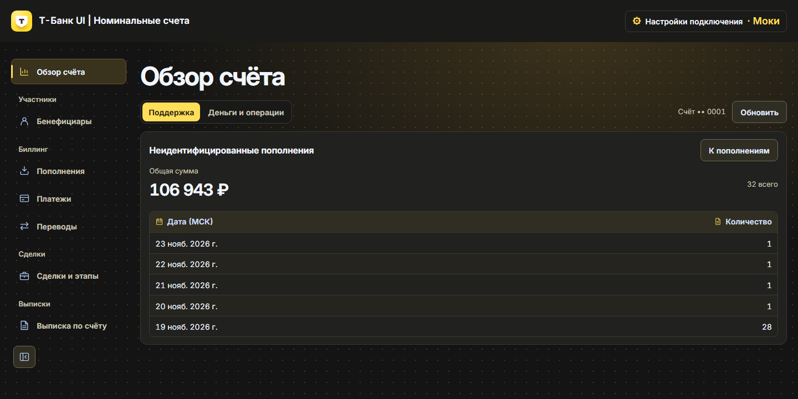
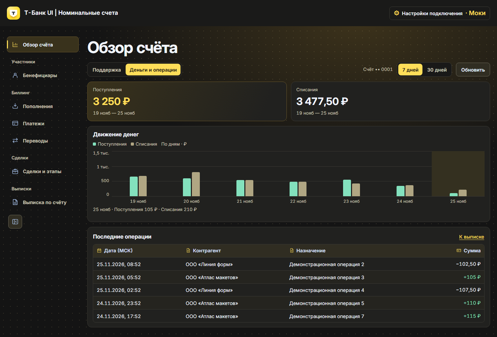
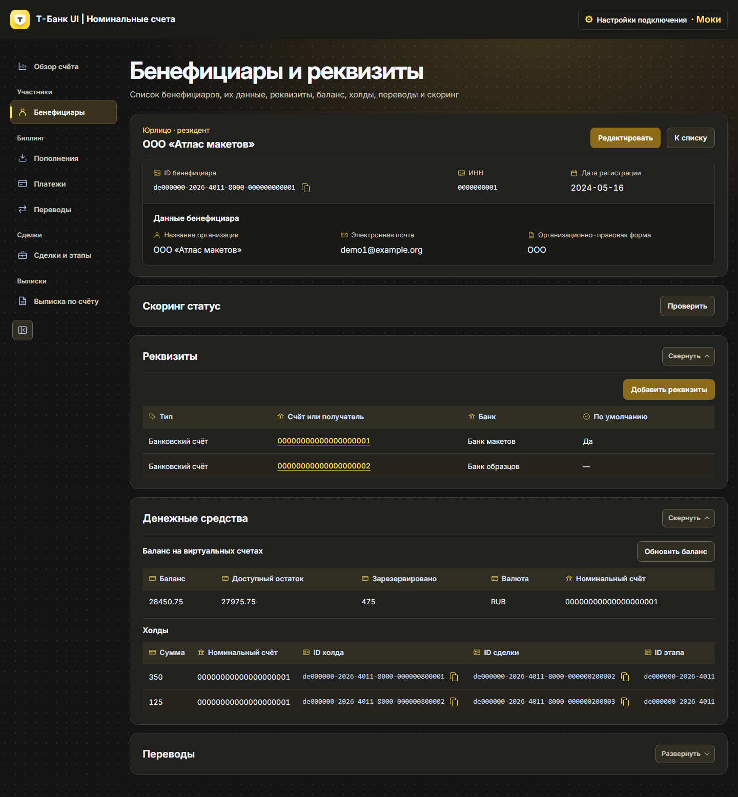
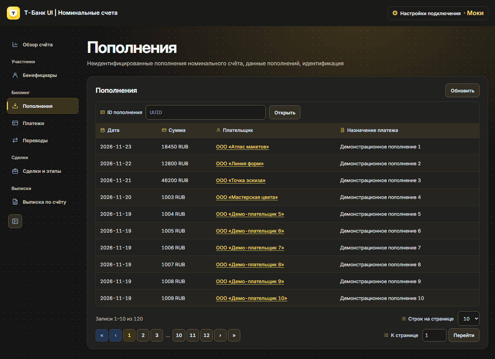
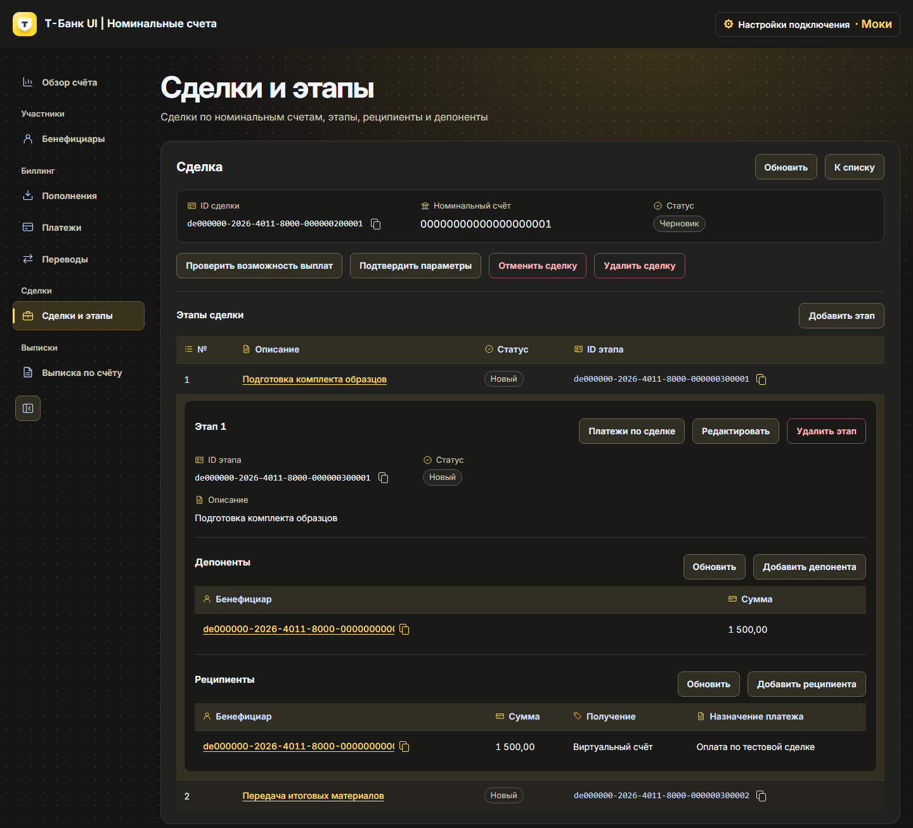

# Т-Банк UI 1.0.1 | Номинальные счета

Локальный инструмент для оператора номинальных счетов. Он работает в браузере через прокси вашей организации и поддерживает 47 операций T‑API. Для подключения нужен действующий Bearer-токен.

## Что изменилось в 1.0.1

- «Поддержка» открывается первой и показывает неидентифицированные пополнения. Сводка и первая страница раздела «Пополнения» используют одну загрузку.
- Во вкладке «Деньги и операции» остались движение денег, суммы поступлений и списаний и последние проведённые операции. Для выбранного периода выполняется один запрос выписки.
- Исправлена маршрутизация выписки для префиксов с `/api` и без него. Запрос выписки передаёт настроенный `bankAccountId`.
- `proxy.cfg` поставляется как единый файл для настройки DEV, STAGE и PROD.

Полный список изменений и результаты проверок приведены в [отчёте выпуска 1.0.1](docs/release-1.0.1.md). На скриншотах показаны вымышленные организации, реквизиты и операции.

## Быстрый старт на Windows

1. Скачайте **Source code (zip)** со страницы [выпуска 1.0.1](https://github.com/ramzeka/tbank-ui/releases/tag/v1.0.1) и распакуйте архив целиком.
2. Если прокси доступен из внутренней сети, подключитесь к ней или к VPN.
3. Настройте [proxy.cfg](proxy.cfg) рядом со `start.cmd` для нужных окружений. После изменения файла перезапустите приложение.
4. Дважды щёлкните `start.cmd`. Интерфейс откроется по адресу `http://127.0.0.1:8765/`.
5. Откройте **Настройки подключения** и выберите **Окружение**. Рядом с именем в списке показаны сервер и порт, если он нестандартный. Заполните параметры счёта и нажмите **Сохранить настройки**.
6. В блоке **Вход по Bearer-токену** вставьте access token или строку `Bearer <token>` и нажмите **Войти**. Откроется **Обзор счёта**.
7. Чтобы остановить сервер, закройте окно или вкладку терминала, в которой работает `start.cmd`.

Для запуска достаточно встроенного Windows PowerShell и современного браузера. Установка пакетов, права администратора и изменение политики выполнения PowerShell не требуются. Оставьте `start.cmd`, `server.commands` и папку `dist` рядом.

## Подключение и данные

Файл `proxy.cfg` читается при запуске. Укажите HTTPS-адреса окружений, которыми пользуетесь. В адрес можно включить порт и путь шлюза. Параметры запроса в URL не поддерживаются. Ниже приведены демонстрационные адреса.

```ini
dev=https://dev.proxy.example.org:8443
stage=https://stage.proxy.example.org/gateway
stage.prefix=/v1/nominal-accounts
prod=https://prod.proxy.example.org
```

Пустой `.prefix` означает стандартный `/api/v1/nominal-accounts`. В примере STAGE прокси получает запрос выписки по пути `/gateway/v1/statement`. При стандартном префиксе запрос выписки идёт на `/api/v1/statement` относительно базового адреса прокси.

| Поле | Что указать |
| --- | --- |
| Базовый URL прокси | Берётся из настроек запуска выбранного окружения. |
| Путь к номинальным счетам | По умолчанию `/api/v1/nominal-accounts`. Для другого пути задайте `.prefix` нужного окружения в `proxy.cfg`. |
| `bankAccountId` | UUID номинального счёта, если его требует прокси. UI передаёт его в одноимённом заголовке запросов номинальных счетов и выписки. |
| `accountNumber` | Для «Поддержки» и списка переводов нужен номер номинального счёта из 20 или 22 цифр. Для выписки и «Деньги и операции» нужен номер из 20 цифр. |
| Access token | Действующий токен, который принимает ваш прокси. |

Для «Поддержки» требуется доступ **Управление номинальными счетами**. Для выписки и «Деньги и операции» требуется **Счета и выписки → Информация об операциях компании**. [Список неидентифицированных пополнений в T‑API](https://developer.tbank.ru/docs/api/get-api-v-1-nominal-accounts-incoming-transactions) · [Выписка по счёту в T‑API](https://developer.tbank.ru/docs/api/get-api-v-1-statement)

В новом профиле браузера адрес подставляется из выбранного окружения. Идентификатор счёта и номер счёта вводятся отдельно. Кнопка **Сохранить настройки** записывает параметры подключения в `localStorage` отдельно для каждого окружения. Выбор другого окружения завершает текущий сеанс и подставляет сохранённые параметры выбранного окружения. Имя активного окружения видно в шапке.

Токен хранится в памяти вкладки. Для JWT с полем `exp` в шапке отображается время до окончания сеанса. При истечении срока или ответе метода `401` интерфейс закрывает карточки и очищает формы, включая введённые данные. После выбора окружения, перезагрузки страницы, истечения срока или `401` введите токен для активного подключения.


## Обзор счёта

- **Поддержка** показывает сумму неидентифицированных пополнений и количество по датам МСК. Вкладка запрашивает первые 50 записей одним вызовом. Если список длиннее, показывает общее количество из ответа банка и помечает сумму и разбивку как частичные. Кнопка **К пополнениям** открывает уже загруженную первую страницу.
- **Деньги и операции** показывает поступления, списания, график движения денег и последние проведённые операции за 7 или 30 календарных дней по Москве. Для каждого периода вкладка запрашивает одну выписку с `limit=5000`. Если банк вернул курсор, показатели рассчитываются по загруженной части. Продолжение доступно в разделе **Выписка**.

Кнопка **Обновить** обновляет данные активной вкладки.





## Поддерживаемые методы

Сокращённые пути указаны относительно `/api/v1/nominal-accounts`. Ссылка в первом столбце ведёт к описанию метода в T‑API. Данные для таблиц и карточек приложение получает через прокси, указанный в настройках. [Номинальные счета в T‑Bank Dev Portal](https://developer.tbank.ru/docs/products/nominal)

### Бенефициары

| Метод T‑API | Что делает интерфейс |
| --- | --- |
| [`GET /beneficiaries`](https://developer.tbank.ru/docs/api/get-api-v-1-nominal-accounts-beneficiaries) | Список с пагинацией по `offset` и `limit`. При открытии раздела UI загружает первые 50 записей. |
| [`GET /beneficiaries/{beneficiaryId}`](https://developer.tbank.ru/docs/api/get-api-v-1-nominal-accounts-beneficiaries-beneficiaryid) | Карточка по UUID. В разделе бенефициаров показывает детальные данные, в форме идентификации пополнения — имя или название, тип и ИНН при наличии. |
| [`POST /beneficiaries`](https://developer.tbank.ru/docs/api/post-api-v-1-nominal-accounts-beneficiaries) | Создание бенефициара. Тип определяет поля формы, в том числе адреса и документы. UI передаёт `Idempotency-Key`. |
| [`PUT /beneficiaries/{beneficiaryId}`](https://developer.tbank.ru/docs/api/put-api-v-1-nominal-accounts-beneficiaries-beneficiaryid) | Сохранение изменений из карточки. UI отправляет полные данные выбранного типа вместе с заполненными адресами и документами. |
| [`GET /api/v2/nominal-accounts/beneficiaries/scoring`](https://developer.tbank.ru/docs/api/get-api-v-2-nominal-accounts-beneficiaries-scoring) | Кнопка **Проверить** запрашивает результат финансового мониторинга по `beneficiaryId`. Карточка показывает статус, ошибки и предупреждения из ответа. |

### Банковские реквизиты

| Метод T‑API | Что делает интерфейс |
| --- | --- |
| [`GET /beneficiaries/{beneficiaryId}/bank-details`](https://developer.tbank.ru/docs/api/get-api-v-1-nominal-accounts-beneficiaries-beneficiaryid-bank-details) | При первом раскрытии блока «Реквизиты» UI загружает записи страницами по 50 и показывает их в одной таблице. |
| [`GET /beneficiaries/{beneficiaryId}/bank-details/{bankDetailsId}`](https://developer.tbank.ru/docs/api/get-api-v-1-nominal-accounts-beneficiaries-beneficiaryid-bank-details-bankdetailsid) | Открытие реквизитов по номеру счёта в таблице. Перед редактированием UI запрашивает актуальные данные счёта. |
| [`POST /beneficiaries/{beneficiaryId}/bank-details`](https://developer.tbank.ru/docs/api/post-api-v-1-nominal-accounts-beneficiaries-beneficiaryid-bank-details) | Добавление банковского счёта (`PAYMENT_DETAILS`) по кнопке **Добавить реквизиты**. UI передаёт `Idempotency-Key`. |
| [`PUT /beneficiaries/{beneficiaryId}/bank-details/{bankDetailsId}`](https://developer.tbank.ru/docs/api/put-api-v-1-nominal-accounts-beneficiaries-beneficiaryid-bank-details-bankdetailsid) | Сохранение изменений банковских реквизитов из формы редактирования. |
| [`POST /beneficiaries/{beneficiaryId}/bank-details/{bankDetailsId}/set-default`](https://developer.tbank.ru/docs/api/post-api-v-1-nominal-accounts-beneficiaries-beneficiaryid-bank-details-bankdetailsid-set-default) | Назначение выбранного счёта основным после подтверждения. Результат виден в столбце **По умолчанию**. |
| [`DELETE /beneficiaries/{beneficiaryId}/bank-details/{bankDetailsId}`](https://developer.tbank.ru/docs/api/delete-api-v-1-nominal-accounts-beneficiaries-beneficiaryid-bank-details-bankdetailsid) | Удаление выбранных реквизитов после подтверждения и обновление таблицы. |

### Остатки на виртуальных счетах

| Метод T‑API | Что делает интерфейс |
| --- | --- |
| [`GET /virtual-accounts/balances`](https://developer.tbank.ru/docs/api/get-api-v-1-nominal-accounts-virtual-accounts-balances) | Запрос при первом раскрытии блока «Денежные средства», по кнопке **Обновить баланс** или при проверке бенефициара в форме распределения пополнения. UI передаёт `beneficiaryId`, `offset`, `limit=50` и `accountNumber`, если он задан в настройках. |
| [`GET /virtual-accounts/holds`](https://developer.tbank.ru/docs/api/get-api-v-1-nominal-accounts-virtual-accounts-holds) | Холды рядом с остатком в карточке бенефициара. Фильтры совпадают с параметрами запроса баланса. |

### Пополнения и идентификация

| Метод T‑API | Что делает интерфейс |
| --- | --- |
| [`GET /incoming-transactions`](https://developer.tbank.ru/docs/api/get-api-v-1-nominal-accounts-incoming-transactions) | Список неидентифицированных пополнений. Поддерживает `offset`, `limit` до 50 и `accountNumber` из настроек. По клику на плательщика открывается карточка операции. |
| [`POST /incoming-transactions/{operationId}/identify`](https://developer.tbank.ru/docs/api/post-api-v-1-nominal-accounts-incoming-transactions-operationid-identify) | Распределение платежа. UI передаёт в `amountDistribution` пары `beneficiaryId` и `amount`, проверяет совпадение общей суммы с платежом до копейки и обновляет список после успешного ответа. |

### Платежи

| Метод T‑API | Что делает интерфейс |
| --- | --- |
| [`GET /payments`](https://developer.tbank.ru/docs/api/get-api-v-1-nominal-accounts-payments) | Список платежей с суммой, получателем, назначением и статусом. Кнопка **Фильтры** задаёт `beneficiaryId` и `dealId` и показывает количество применённых фильтров. UI передаёт `offset`, `limit` и номер номинального счёта, если он задан в настройках. |
| [`GET /payments/{paymentId}`](https://developer.tbank.ru/docs/api/get-api-v-1-nominal-accounts-payments-paymentid) | Открывает карточку платежа по ID из поля поиска или из строки списка. |
| [`POST /payments`](https://developer.tbank.ru/docs/api/post-api-v-1-nominal-accounts-payments) | Прямой обычный платёж с виртуального счёта. Укажите сумму, назначение и выберите сохранённые реквизиты бенефициара. UI отправляет `Idempotency-Key`. |
| [`POST /payments/{paymentId}/retry`](https://developer.tbank.ru/docs/api/post-api-v-1-nominal-accounts-payments-paymentid-retry) | Повтор неуспешного платежа по сделке. ID новой попытки открывается из исходной карточки. Из этапа кнопка **Платежи по сделке** открывает список с фильтром по `dealId`. |

### Переводы

| Метод T‑API | Что делает интерфейс |
| --- | --- |
| [`GET /virtual-accounts/transfers`](https://developer.tbank.ru/docs/api/get-api-v-1-nominal-accounts-virtual-accounts-transfers) | Список переводов с ID участников из ответа API, пагинацией и фильтрами `dealId`, `fromBeneficiaryId`, `toBeneficiaryId`. В карточке бенефициара входящие и исходящие раскрываются, загружаются и перелистываются отдельно. Для списков нужен номер номинального счёта из настроек подключения. |
| [`GET /virtual-accounts/transfers/{transferId}`](https://developer.tbank.ru/docs/api/get-api-v-1-nominal-accounts-virtual-accounts-transfers-transfer-id) | Карточка по ID из поля поиска или строки списка. Показывает данные участников из ответа и их ID с кнопками копирования. |
| [`POST /virtual-accounts/transfers`](https://developer.tbank.ru/docs/api/post-api-v-1-nominal-accounts-virtual-accounts-transfers) | Перевод между бенефициарами в рамках одного номинального счёта. UI передаёт `from`, `to`, сумму, назначение при наличии и `Idempotency-Key`. |

### Выписки

В разделе **Выписки → Выписка по счёту** укажите 20-значный номер счёта. По умолчанию выбран последний месяц. Период можно задать вручную с точностью до минуты по Москве. UI отправляет время в UTC. Если поле конца периода пустое, UI опускает параметр `to`.

Под периодом доступны фильтры по статусу операции, категориям, ИНН контрагентов и UCID карты. Параметр **Показать балансы за период** добавляет данные о балансах с первой страницы. Переходы **Назад** и **Далее** используют курсоры из ответа банка. Размер страницы задаёт `limit`. [Метод получения выписки](https://developer.tbank.ru/docs/api/get-api-v-1-statement)

По умолчанию путь выписки относительно базового URL — `GET /api/v1/statement`. Если в стандартном префиксе номинальных счетов опущен сегмент `/api`, выписка использует `/v1/statement`. Прокси направляет этот запрос на метод выписки Т‑Банка. Для токена нужен доступ **Счета и выписки → Информация об операциях компании**.

### Сделки

| Метод T‑API | Что делает интерфейс |
| --- | --- |
| [`GET /deals`](https://developer.tbank.ru/docs/api/get-api-v-1-nominal-accounts-deals) | Список со статусом, номером номинального счёта и пагинацией. |
| [`POST /deals`](https://developer.tbank.ru/docs/api/post-api-v-1-nominal-accounts-deals) | Создание сделки по номеру номинального счёта с `Idempotency-Key`. |
| [`GET /deals/{dealId}`](https://developer.tbank.ru/docs/api/get-api-v-1-nominal-accounts-deals-dealid) | Карточка сделки по введённому ID или по ID из таблицы. |
| [`GET /deals/{dealId}/is-valid`](https://developer.tbank.ru/docs/api/get-api-v-1-nominal-accounts-deals-dealid-is-valid) | Проверка возможности выплат с отображением причин из ответа. |
| [`POST /deals/{dealId}/accept`](https://developer.tbank.ru/docs/api/post-api-v-1-nominal-accounts-deals-dealid-accept) | Подтверждение параметров черновика. |
| [`POST /deals/{dealId}/draft`](https://developer.tbank.ru/docs/api/post-api-v-1-nominal-accounts-deals-dealid-draft) | Возврат подтверждённой сделки в черновик. |
| [`POST /deals/{dealId}/cancel`](https://developer.tbank.ru/docs/api/post-api-v-1-nominal-accounts-deals-dealid-cancel) | Отмена сделки. |
| [`DELETE /deals/{dealId}`](https://developer.tbank.ru/docs/api/delete-api-v-1-nominal-accounts-deals-dealid) | Удаление черновика. |

### Этапы сделок

| Метод T‑API | Что делает интерфейс |
| --- | --- |
| [`GET /deals/{dealId}/steps`](https://developer.tbank.ru/docs/api/get-api-v-1-nominal-accounts-deals-dealid-steps) | Список этапов выбранной сделки с пагинацией по 50. |
| [`POST /deals/{dealId}/steps`](https://developer.tbank.ru/docs/api/post-api-v-1-nominal-accounts-deals-dealid-steps) | Создание этапа с описанием и `Idempotency-Key`. |
| [`GET /deals/{dealId}/steps/{stepId}`](https://developer.tbank.ru/docs/api/get-api-v-1-nominal-accounts-deals-dealid-steps-stepid) | Карточка этапа по ID сделки и этапа. |
| [`PUT /deals/{dealId}/steps/{stepId}`](https://developer.tbank.ru/docs/api/put-api-v-1-nominal-accounts-deals-dealid-steps-stepid) | Изменение описания этапа в черновике. |
| [`DELETE /deals/{dealId}/steps/{stepId}`](https://developer.tbank.ru/docs/api/upravlenie-etapami-sdelok) | Удаление этапа из черновика. |
| [`POST /deals/{dealId}/steps/{stepId}/complete`](https://developer.tbank.ru/docs/api/post-api-v-1-nominal-accounts-deals-dealid-steps-stepid-complete) | Запрос завершения этапа после подтверждения пользователя. Метод может запустить выплаты. |

### Депоненты и реципиенты

Все пути в этой таблице приведены относительно `/deals/{dealId}/steps/{stepId}`. [Раздел T‑API](https://developer.tbank.ru/docs/api/deponenti-i-retsipienti)

| Метод T‑API | Что делает интерфейс |
| --- | --- |
| `GET /deponents`, `GET /deponents/{beneficiaryId}` | Список депонентов с пагинацией и просмотр одной записи. |
| `PUT /deponents/{beneficiaryId}`, `DELETE /deponents/{beneficiaryId}` | Сохранение суммы и удаление депонента в черновике. Один бенефициар может быть депонентом этапа один раз. |
| `GET /recipients`, `GET /recipients/{recipientId}` | Список реципиентов с пагинацией и просмотр записи по отдельному ID реципиента. |
| `POST /recipients`, `PUT /recipients/{recipientId}`, `DELETE /recipients/{recipientId}` | Управление реципиентами в черновике. Один бенефициар может быть указан несколько раз. При создании используется `Idempotency-Key`. |
| [`POST /recipients/{recipientId}/update-bank-details`](https://developer.tbank.ru/docs/api/post-api-v-1-nominal-accounts-deals-dealid-steps-stepid-recipients-recipientid-update-bank-details) | Замена реквизитов после ошибки выплаты. |

## Работа в интерфейсе

Списки бенефициаров, пополнений и сделок загружаются при открытии раздела. Кнопка **Обновить** перезапрашивает текущую страницу. Под таблицей видны количество записей и навигация по страницам. Здесь можно менять размер страницы (10, 25 или 50 строк, для бенефициаров также 100), переходить по номерам и стрелкам. Если прокси возвращает общее количество, доступны последняя страница и прямой переход по номеру для длинных списков.

### Карточка бенефициара

Нажмите **Создать** над списком и выберите тип, чтобы открыть соответствующие поля. Для изменения существующей записи откройте её по имени или UUID и нажмите **Редактировать**. Изменения передаются полным PUT-запросом, включая заполненные адреса и документы.

В блоке **Скоринг статус** кнопка **Проверить** загружает результат финансового мониторинга. Блоки **Реквизиты**, **Денежные средства** и **Переводы** по умолчанию свёрнуты и загружаются при первом раскрытии. Кнопка **Обновить баланс** обновляет баланс и холды. В **Переводах** у входящих и исходящих свои страницы. Клик по ID раскрывает детали сразу под строкой перевода.

В карточке кнопка **Добавить реквизиты** открывает форму банковского счёта. Клик по номеру счёта раскрывает его данные прямо под строкой. Там доступны изменение, назначение основными и удаление. Столбец «По умолчанию» показывает выбранные реквизиты.



### Пополнения

Введите **ID пополнения** и нажмите **Открыть**, чтобы перейти в карточку операции. Если записи нет на открытой странице, поиск проходит по списку неидентифицированных пополнений и показывает прогресс. Поиск можно отменить.

Откройте карточку по имени плательщика или по ID. Кнопка копирования находится рядом с ID операции. Проверьте данные и нажмите **Идентифицировать** под карточкой, чтобы открыть форму распределения платежа.

1. Введите UUID получателя и сумму. По кнопке **Проверить бенефициара** можно посмотреть его данные и остатки прямо в этой строке.
2. Чтобы разделить платёж, нажмите **Добавить бенефициара**. В новой строке появится оставшаяся сумма. Для каждого получателя укажите отдельный UUID и положительную сумму с точностью до копейки.
3. Когда остаток равен нулю, нажмите **Идентифицировать** в форме. После успешного ответа платёж исчезнет из списка. При ошибке валидации форма сохранит распределение и покажет сообщение прокси.
4. Если результат отправки неизвестен, нажмите **Проверить пополнение**. Интерфейс ищет ID в актуальном списке. Если пополнение с той же суммой и валютой всё ещё в списке, можно повторить отправку. Если запись исчезла, сверьте итог по ID операции и остаткам бенефициаров.



### Сделки и этапы

В разделе **Сделки и этапы** введите **ID сделки** и нажмите **Открыть** или выберите ID в таблице. Этапы отображаются внутри сделки. Описание этапа в таблице открывает его карточку. **Создать сделку** над списком сделок открывает форму с номером номинального счёта, а **Добавить этап** в черновике — форму с описанием этапа.

Депоненты и реципиенты настраиваются в карточке этапа в черновике. Клик по ID бенефициара раскрывает под строкой данные участника из ответа API и доступные кнопки. Для добавления укажите ID существующего бенефициара и сумму. Реципиенту можно выбрать виртуальный счёт или указать ID его банковских реквизитов. Кнопка **Проверить бенефициара** в форме показывает имя и подсказывает реквизиты при выборе выплаты на банковский счёт.

Перед завершением этапа подтвердите параметры сделки и проверьте возможность выплат. Если виртуального остатка депонента недостаточно, идентифицируйте его пополнение в разделе **Пополнения**. После ошибки выплаты в деталях реципиента доступна кнопка **Обновить реквизиты**. [Порядок расчётов](https://developer.tbank.ru/docs/products/nominal) · [Управление этапами](https://developer.tbank.ru/docs/api/upravlenie-etapami-sdelok)



### Скриншоты разделов

| Раздел | Скриншот |
| --- | --- |
| Бенефициары | [Список бенефициаров](docs/screenshots/beneficiaries.png) |
| Платежи | [История исходящих платежей](docs/screenshots/payments.png) |
| Переводы | [Переводы между виртуальными счетами](docs/screenshots/transfers.png) |
| Сделки и этапы | [Список сделок](docs/screenshots/deals.png) |
| Выписка | [Период, фильтры и операции по счёту](docs/screenshots/statement.png) |

## Как проходит запрос

Браузер обращается к серверу на `127.0.0.1`. Сервер сверяет выбранное окружение, адрес, метод и нормализованный путь перед пересылкой запроса. Настроенный прокси обеспечивает подключение к T‑API с банковским токеном и сертификатом mTLS.

Для скоринга приложение заменяет окончание пути `/v1/nominal-accounts` на `/v2/nominal-accounts`. Если в настройках задан другой путь, прокси должен направлять запрос `GET {путь}/beneficiaries/scoring` в метод T‑API v2.

При создании бенефициара, банковских реквизитов, сделки, этапа, реципиента, прямого платежа или перевода приложение сохраняет `Idempotency-Key` до отправки запроса. Вкладки одного профиля на одном адресе приложения используют общий журнал и блокируют одновременную отправку одинаковых запросов. После подтверждённой записи новое создание получает новый ключ. Прокси должен передавать этот заголовок, метод, путь и тело запроса в T‑API.

Если результат неизвестен, сверьте операцию перед повтором. В том же профиле при повторной отправке тех же данных приложение использует прежний ключ. Для безопасного восстановления с другого устройства и после окончания срока действия ключа нужны сверка и гарантия однократного исполнения со стороны шлюза.

## Отладка и ошибки

Откройте **DevTools → Network** и выберите запрос с префиксом `/api/relay/`. После префикса видны путь и query-параметры, а в `X-TBank-Proxy-Origin` — адрес узла прокси. В **Status** указан HTTP-статус транспорта, в **Response** — ответ прокси.

При успешном HTTP-ответе прокси значение `responseCode` уточняет статус метода. При HTTP-ошибке используется транспортный статус. Публичная диагностика показывает статус, допустимый код и ID запроса при наличии. Ошибка валидации подсвечивает известные поля формы. Транспортный `401` завершает сеанс, а `5xx` сохраняет ключ незавершённой операции.

## Файлы проекта

| Файл | Назначение |
| --- | --- |
| `start.cmd`, `server.commands` | Запуск на Windows, выдача статических файлов и пересылка запросов к прокси. |
| `dist/index.html`, `dist/styles.css` | Страницы, формы, таблицы и оформление. |
| `dist/identify.js` | Распределение пополнений, проверка данных и остатков получателя по UUID. |
| `dist/deals.js` | Карточки сделок и этапов, проверка выплат, формы и смена статусов. |
| `dist/billing.js`, `dist/transfers.js`, `dist/statement.js` | Платежи, переводы и выписка. |
| `dist/dashboard.js`, `dist/dashboard-data.js` | Сводка по неидентифицированным пополнениям и финансовый обзор по выписке. |
| `dist/step-parties.js`, `dist/amount.js` | Участники этапа и обработка денежных сумм. |
| `dist/app.js` | Подключение, авторизация, запросы, пагинация и отображение пополнений. |
| `dist/beneficiaries.js`, `dist/beneficiary-schema.js`, `dist/entity-editor.js` | Карточки, реквизиты, описания полей и справочники. |

HTML, CSS и JavaScript в `dist` используются напрямую. После изменения файлов перезапустите `start.cmd` и обновите страницу. Шрифт Inter поставляется по лицензии SIL Open Font License. [Текст лицензии](dist/Inter-OFL.txt)

## Автотесты и результаты выпуска

Для тестов нужны Windows, Node.js 24 и Microsoft Edge. Запуск из корня репозитория:

```powershell
node tests/qa/run.mjs
node tests/qa/run.mjs --scale
```

| Прогон | Результат 1.0.1 |
| --- | --- |
| Браузерные и HTTP-тесты на моках | **58 из 58**, включая 9 проверок безопасности и 47 HTTP-операций |
| Масштабный прогон | **3 из 3** на 50 000 бенефициарах, 20 000 платежах и 20 000 пополнениях |
| Скриншоты | 11 кадров интерфейса на синтетических данных |

Проверки выпуска выполнены на локальном прокси и моках в одном профиле браузера. Моки, команды ручного запуска и перечень сценариев описаны в [документации автотестов](tests/qa/README.md). Границы проверки приведены в [отчёте выпуска 1.0.1](docs/release-1.0.1.md).
